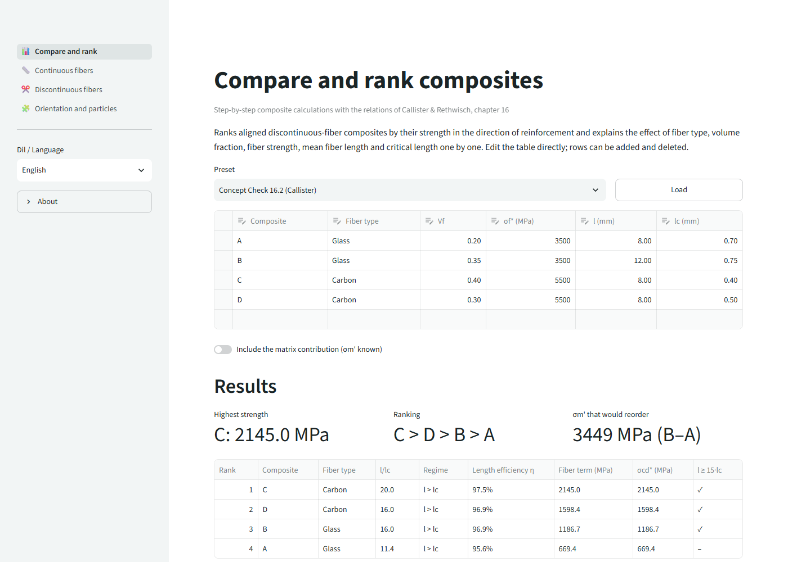
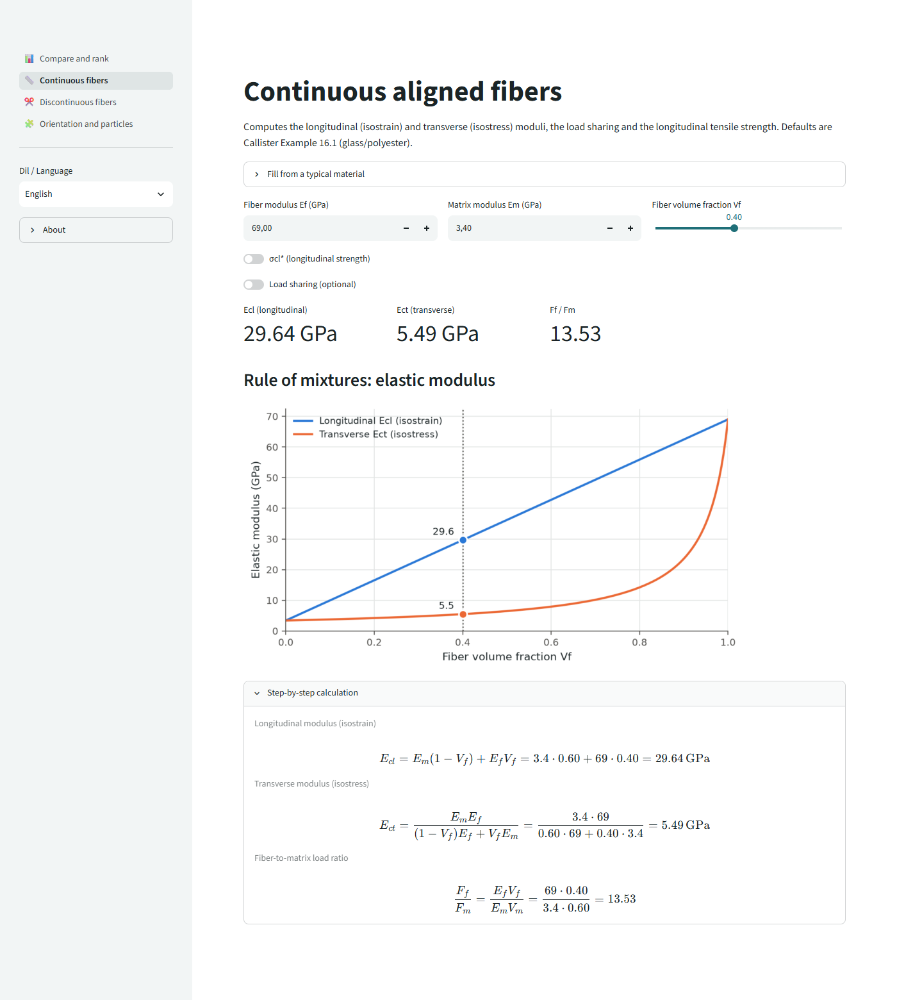
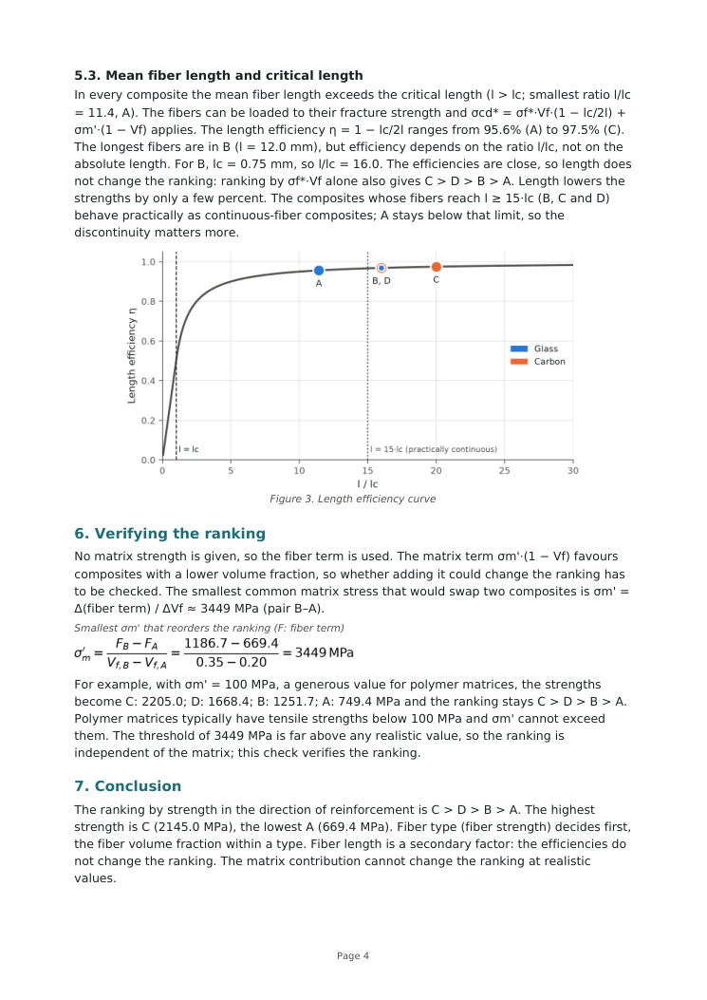

# Fiber Composite Calculator

[](https://fiber-composite-calculator.streamlit.app/)
[](https://github.com/DailyDana/fiber-composite-calculator/actions/workflows/ci.yml)
[](https://www.python.org/downloads/)
[](LICENSE)

A calculator for fiber-reinforced composites, built on the relations in chapter 16 of
Callister & Rethwisch, *Materials Science and Engineering: An Introduction*. You enter your
composites, it ranks them by strength along the fibers, explains why the ranking comes out
the way it does, and writes it all up as a PDF with every step of the math.

Try it without installing anything: **[fiber-composite-calculator.streamlit.app](https://fiber-composite-calculator.streamlit.app/)**
(Turkish: [?lang=tr](https://fiber-composite-calculator.streamlit.app/?lang=tr)).



## What's in it

- **Compare and rank.** An editable table of aligned discontinuous-fiber composites (fiber
  type, Vf, σf\*, mean length l, critical length lc). You get the strengths, an l/lc chart,
  a written explanation for each factor and a downloadable PDF report.
- **Continuous fibers.** Longitudinal and transverse modulus, how the load splits between
  fiber and matrix, longitudinal strength.
- **Discontinuous fibers.** Critical length from σf\*, d and τc, and how strength changes
  with fiber length.
- **Orientation and particles.** The fiber efficiency factor K, and the upper and lower
  bounds for large-particle composites.

Every page has a step-by-step panel: the formula, the numbers put in, the result. The
interface and the reports are in English and Turkish; `?lang=tr` or `?lang=en` in the URL
picks one.



## How the ranking is checked

Exercises like Callister's Concept Check 16.2 give fiber data but nothing about the matrix,
so the ranking is made on the fiber term σf\*·Vf·(1 − lc/2l). The matrix term
σm'·(1 − Vf) could still matter, because it favours composites with less fiber. The app
works out the smallest common σm' that would swap any two composites. For the 16.2 data that
is about 3450 MPa (pair B–A), far above anything a polymer matrix can carry, so the ranking
C > D > B > A holds. The report shows this calculation and repeats the ranking with
σm' = 100 MPa to make the point concrete.



All formulas, with notes on where each one comes from, are in [docs/FORMULAS.md](docs/FORMULAS.md).

## Running it

```bash
python -m venv .venv
.venv\Scripts\activate            # Linux/macOS: source .venv/bin/activate
pip install -r requirements.txt
streamlit run app/ui/streamlit_app.py
```

## Tests

```bash
python -m pytest
```

The tests pin the textbook results (Example 16.1: Ecl ≈ 30 GPa, Ff/Fm ≈ 13.5, Ect ≈ 5.5 GPa;
Concept Check 16.2: 2145.0 / 1598.4 / 1186.7 / 669.4 MPa), parse every formula line the
PDF will draw, extract the PDF text to make sure Turkish characters survive, and run each
page headlessly with Streamlit's AppTest.

## Layout

```
app/core/        formulas, data models, ranking and the matrix threshold
app/interpret/   rule-based explanations and the step-by-step lines
app/i18n/        English and Turkish strings, number formatting
app/charts/      matplotlib figures shared by the app and the PDF
app/reporting/   A4 PDF report (reportlab)
app/ui/          Streamlit pages
```

## Limits

The numbers come from the textbook models: aligned fibers, perfect bonding, rule-of-mixtures
behaviour. They are good for learning and for comparing options, not for design. The typical
material values in the presets are approximate. Laminate theory (ABD matrix, failure criteria)
is not in yet.

## Türkçe

Callister Bölüm 16 bağıntılarıyla çalışan bir kompozit hesaplayıcı. Kompozitleri girersiniz;
program onları elyaf doğrultusundaki dayanıma göre sıralar, her etkenin sonuca katkısını
yazıyla açıklar ve tüm adımları içeren bir PDF rapor üretir. Sürekli/süreksiz elyaf, yönlenme
verimi ve parçacık kompozit sayfaları da var. Arayüz Türkçe açılır; kenar çubuğundan
İngilizceye geçilebilir.

## License

Apache-2.0, see [LICENSE](LICENSE) and [NOTICE](NOTICE). The bundled DejaVu fonts keep their
own license ([assets/fonts/LICENSE-DejaVu.txt](assets/fonts/LICENSE-DejaVu.txt)).
